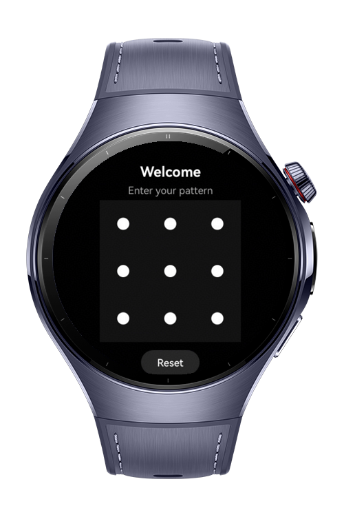
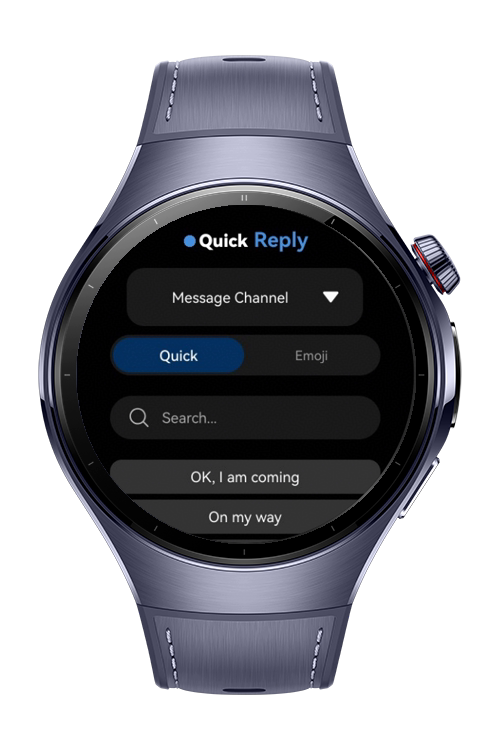
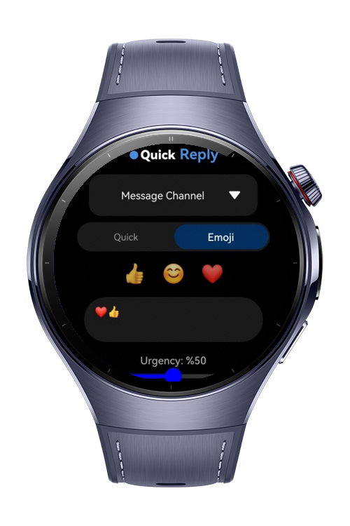

> **Note:** To access all shared projects, get information about environment setup, and view other guides, please visit [Explore-In-HMOS-Wearable Index](https://github.com/Explore-In-HMOS-Wearable/hmos-index).

# How to Build Quick Reply Input Deck

This codelab demonstrates a sophisticated user interface designed specifically for small-screen wearable devices. It
features a secure **PatternLock** entry system and a comprehensive **Quick Reply** dashboard. The project showcases
advanced ArkUI capabilities such as `MutableStyledString` for rich text, `Canvas` for custom drawing, and dynamic UI
state management.

# Preview

<div>
  
  
  
</div>

# Use Cases

- **Secure Access Control**: Implements a `PatternLock` system to gate-keep the input deck with real-time feedback.
- **Rich Text Branding**: Uses `MutableStyledString` to create a dual-styled header ("Quick" in Bold White, "Reply" in
  Light Blue) within a single `Text` component.
- **Dynamic Input Methods**: Toggle between a searchable quick-reply list and an emoji selection row using
  a `SegmentButton`.
- **Custom Graphic Indicators**: Utilizes `DrawingRenderingContext` on a `Canvas` to draw a custom status indicator
  using the `drawing.Brush` API.
- **Contextual Visual Feedback**: A slider that changes color (Blue to Red) based on the "Urgency" level, providing
  haptic feedback.

# Technology

## Stack

- **Languages**: ArkTS, ArkUI
- **Frameworks**: HarmonyOS SDK 5.0.2(14)
- **Tools**: DevEco Studio Version 5.1.0.828+
- **Libraries**:
  - `@kit.ArkUI` (UI Components & Layouts)
  - `@kit.ArkGraphics2D` (Custom Canvas Drawing & Graphics)
  - `@kit.PerformanceAnalysisKit` (Optimization)
  - `@kit.AbilityKit` (Application Framework)

## Key Technical Implementations

- **PatternLock**: Secure pattern verification with custom challenge results.
- **StyledString API**: Dynamic per-character styling and range-based text modification.
- **Drawing Engine**: Manual brush and circle rendering via `drawing` module for granular UI control.
- **Wearable Optimization**: Responsive layout and touch targets tailored for Huawei Watch series.

# Directory Structure

```
QuickReplyDeck
|--- entry/src/main/ets/
| |--- pages/
| | |--- Index.ets          # Main logic and UI structure
| |
| |--- resources/           # App icons, media, and raw assets
| |--- screenshots/         # UI Preview images for documentation
```

# Constraints and Restrictions

## Supported Device

* Huawei Watch 4 Series
* Huawei Watch 5 Series
* Circular Screen Wearables (UI optimized via `.clip` and `.width/height` constraints)

# License

**QuickReplyInputDeck** is distributed under the terms of the MIT License.
See the [LICENSE](./LICENSE) for more information.